<div align="center">

<h1>anokiX Distributor — Android</h1>

**The wholesale supply side of the anokiX B2B commerce platform, built natively for Android.**

List products, manage warehouse stock and stores, onboard traders, fulfil and deliver orders,
run promotions and settle finances — from a phone.

[](#)
[-3DDC84?style=flat-square)](#)
[](#)
[](#)
[](#)
[](LICENSE)

<br>

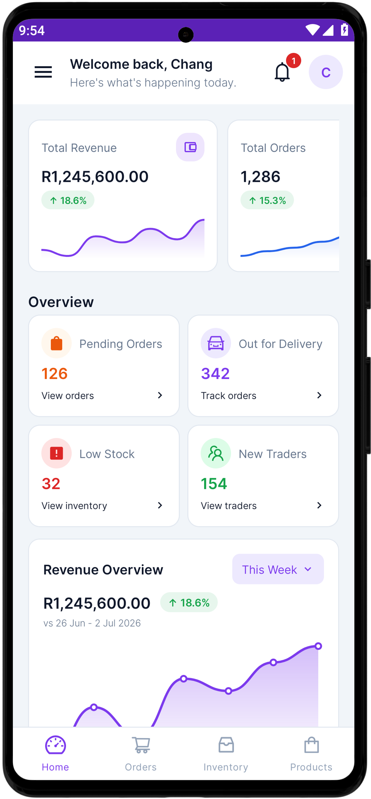
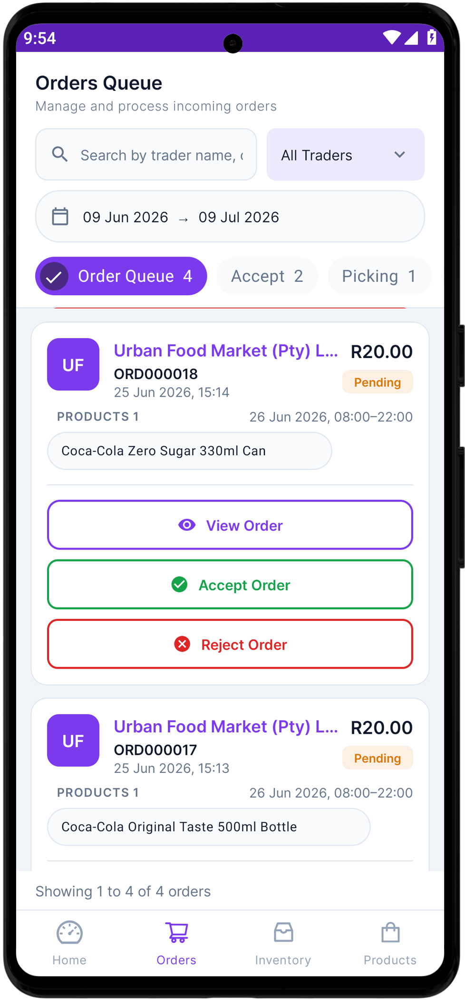
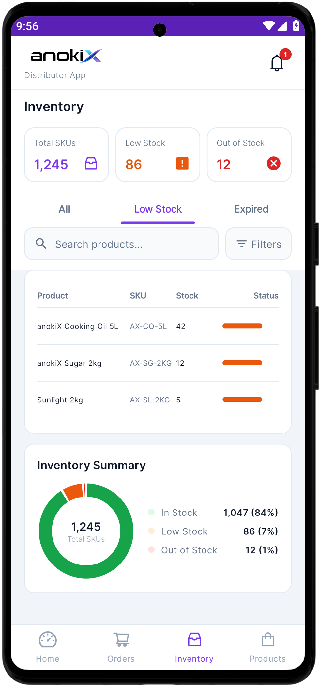
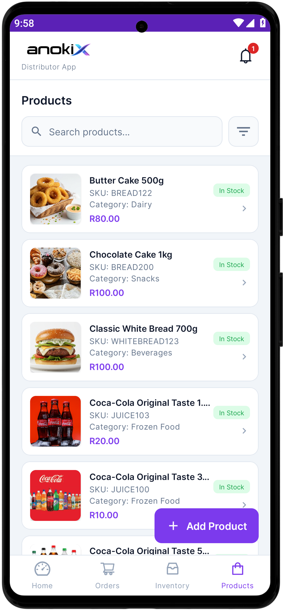

</div>

---

## About

anokiX connects **distributors** (wholesale suppliers) with **traders** (retail shops). This is the distributor's app — a wholesaler's control room showing what's selling, what's in stock, which orders need picking and which traders are buying.

It is one of four native apps in the platform: a Distributor and a Trader app, each built separately for Android and iOS against one shared REST API. The iOS counterpart is a deliberate port of this app — same screens, same API contract, same design language.

> [!NOTE]
> **The backend API is currently offline.** This repository is published as a reference for the app's **UI and user flows** — every screenshot below is a real capture from the running app, served by the bundled mock repository. To run against live data, point it at your own backend and supply your own keys (see [Configuration](#configuration)).

---

## Screens and flows

### Sign in and get oriented

A dark branded splash leads to a login sheet with email or phone tabs. The dashboard opens on revenue and order KPIs, then an overview grid — pending orders, out for delivery, low stock, new traders — a revenue chart, a top-selling-category donut and recent orders.

<table>
<tr>
<td>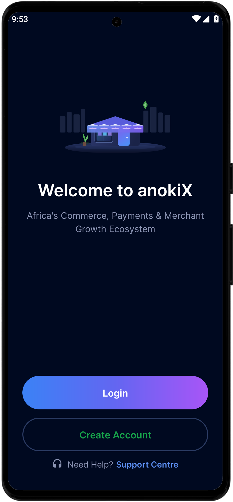</td>
<td>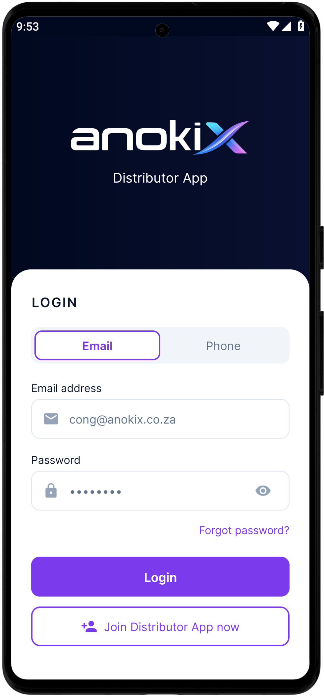</td>
<td></td>
<td>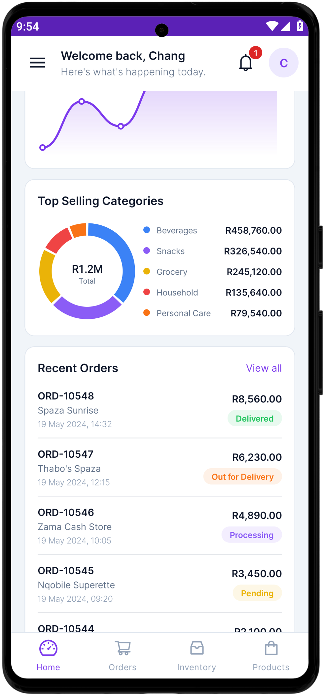</td>
</tr>
<tr>
<td align="center"><sub>Splash</sub></td>
<td align="center"><sub>Login</sub></td>
<td align="center"><sub>Dashboard</sub></td>
<td align="center"><sub>Categories &amp; recent orders</sub></td>
</tr>
</table>

### Order fulfilment

Orders land in a queue tabbed by stage — **Order Queue → Accept → Picking → Packing → Ready for Delivery → Out for Delivery**. Each card carries its actions inline (*Accept* / *Reject*, later *Mark Ready*), so a warehouse clerk advances an order without opening it. The detail screen shows a live tracking timeline, the trader and the line items. Dispatched stock flows into Deliveries; anything sent back flows into Returns, which issues a credit note.

<table>
<tr>
<td></td>
<td>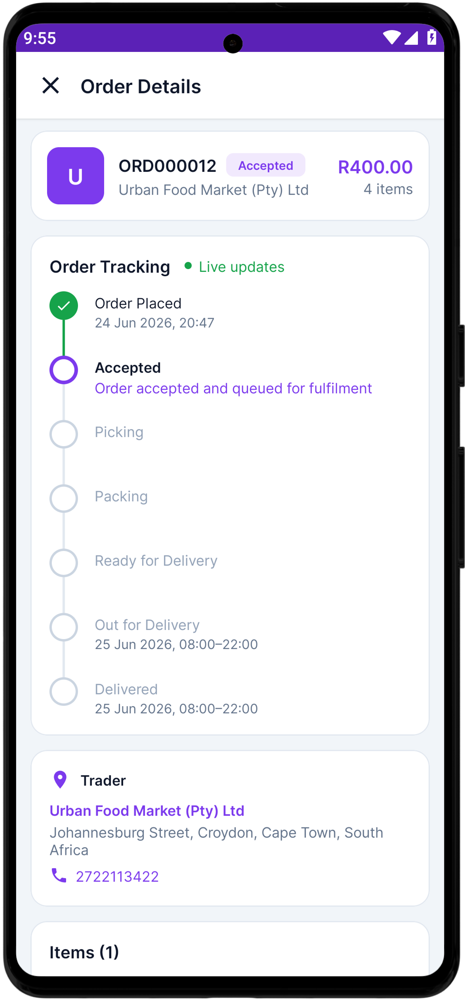</td>
<td>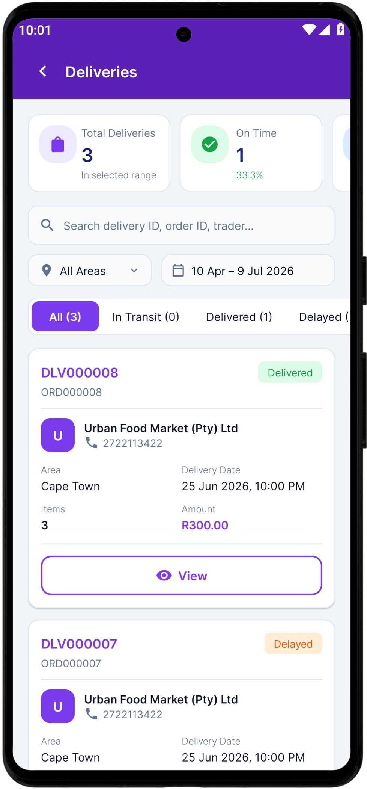</td>
<td>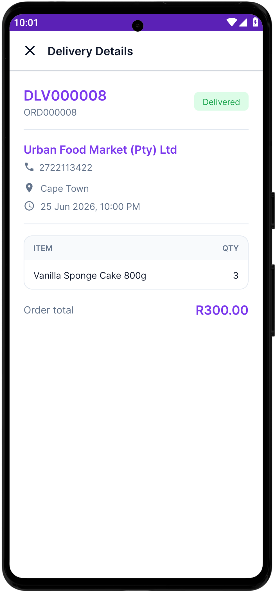</td>
<td>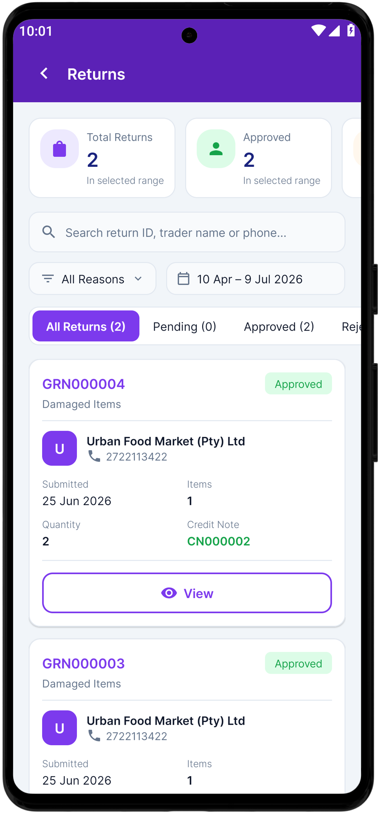</td>
</tr>
<tr>
<td align="center"><sub>Order queue</sub></td>
<td align="center"><sub>Tracking timeline</sub></td>
<td align="center"><sub>Deliveries</sub></td>
<td align="center"><sub>Delivery detail</sub></td>
<td align="center"><sub>Returns</sub></td>
</tr>
</table>

### Catalogue, stock and stores

Products carry SKU, category, price and a stock badge, with search and filters. Inventory shows per-SKU levels with colour-coded fill bars over an in-stock / low / out summary. Stores are created through a two-step form with fulfilment options (Click &amp; Collect, Click &amp; Deliver) and a Google Maps pin for the address.

<table>
<tr>
<td></td>
<td></td>
<td>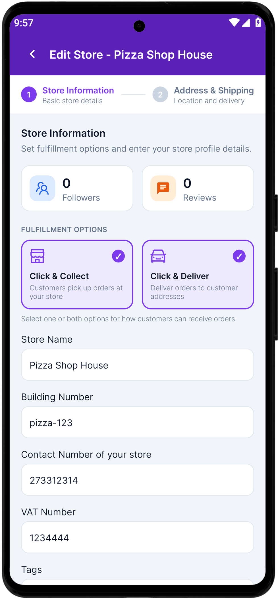</td>
<td>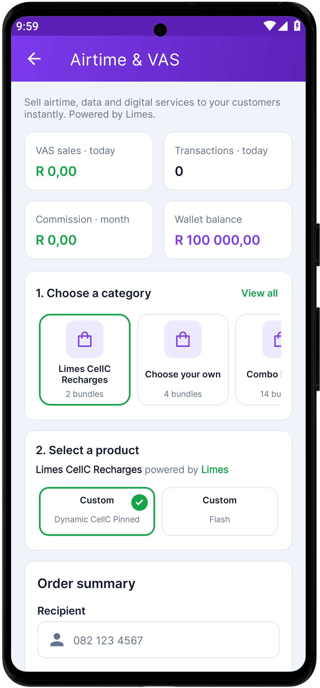</td>
</tr>
<tr>
<td align="center"><sub>Products</sub></td>
<td align="center"><sub>Inventory</sub></td>
<td align="center"><sub>Store form</sub></td>
<td align="center"><sub>Airtime &amp; VAS</sub></td>
</tr>
</table>

### Promotions, money and reporting

Campaigns track budget, reach, clicks and CTR, and drill into a summary with targeting, added products and stock allocation logs. Finances splits income from expenses across a transaction ledger. Reports generates and downloads sales, inventory, trader and finance exports.

<table>
<tr>
<td>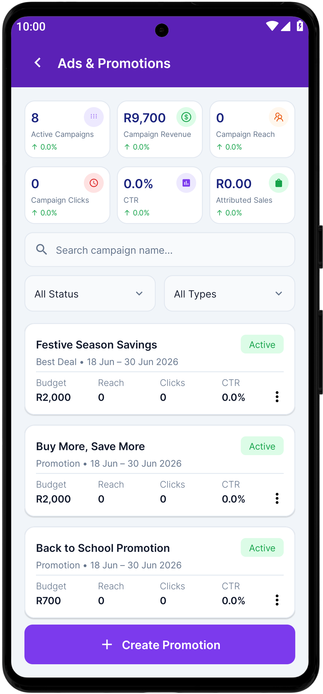</td>
<td>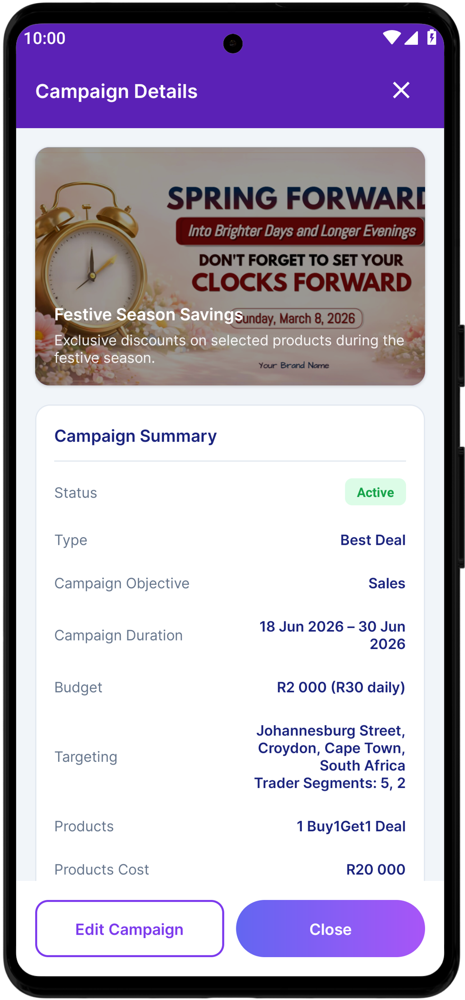</td>
<td>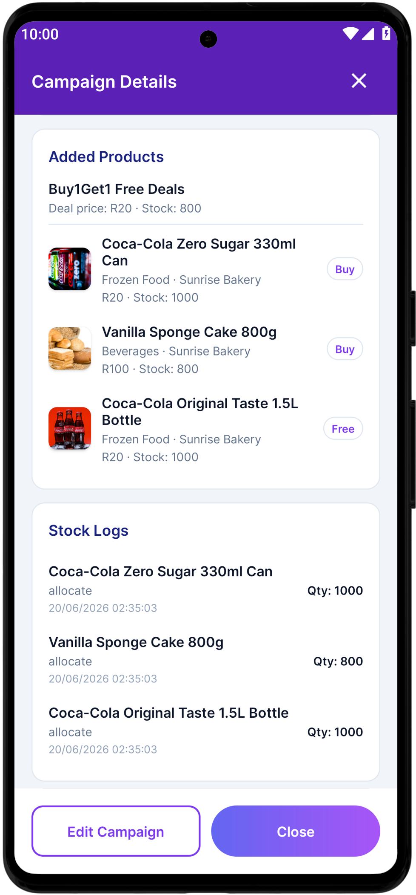</td>
<td>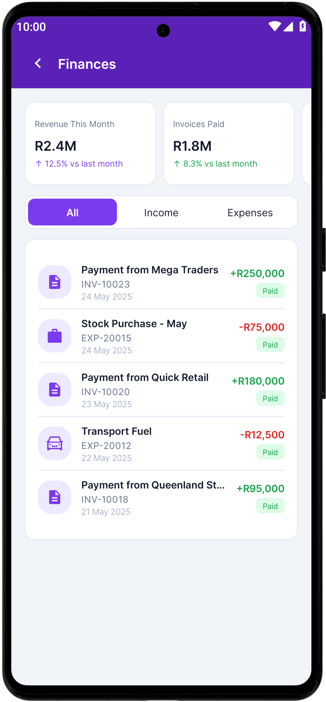</td>
<td>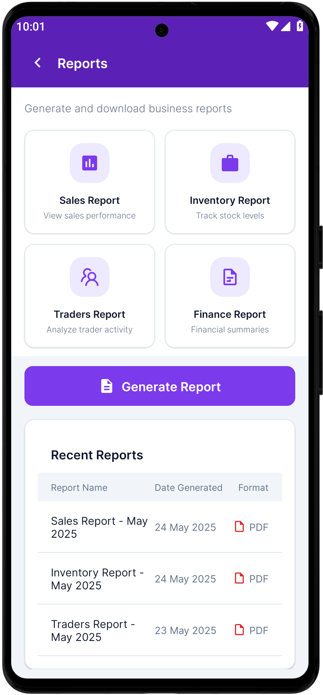</td>
</tr>
<tr>
<td align="center"><sub>Campaigns</sub></td>
<td align="center"><sub>Campaign detail</sub></td>
<td align="center"><sub>Added products</sub></td>
<td align="center"><sub>Finances</sub></td>
<td align="center"><sub>Reports</sub></td>
</tr>
</table>

<details>
<summary><b>All 21 screens</b></summary>

<br>

<table>
<tr>
<td></td>
<td></td>
<td></td>
<td></td>
<td></td>
<td></td>
</tr>
<tr>
<td align="center"><sub>Splash</sub></td><td align="center"><sub>Login</sub></td><td align="center"><sub>Dashboard</sub></td><td align="center"><sub>Categories</sub></td><td align="center"><sub>Orders</sub></td><td align="center"><sub>Order detail</sub></td>
</tr>
<tr>
<td></td>
<td></td>
<td></td>
<td></td>
<td></td>
<td></td>
</tr>
<tr>
<td align="center"><sub>Inventory</sub></td><td align="center"><sub>Store form</sub></td><td align="center"><sub>Products</sub></td><td align="center"><sub>Airtime &amp; VAS</sub></td><td align="center"><sub>Promotions</sub></td><td align="center"><sub>Campaign</sub></td>
</tr>
<tr>
<td></td>
<td></td>
<td></td>
<td></td>
<td></td>
<td></td>
</tr>
<tr>
<td align="center"><sub>Campaign items</sub></td><td align="center"><sub>Finances</sub></td><td align="center"><sub>Reports</sub></td><td align="center"><sub>Deliveries</sub></td><td align="center"><sub>Delivery detail</sub></td><td align="center"><sub>Returns</sub></td>
</tr>
<tr>
<td>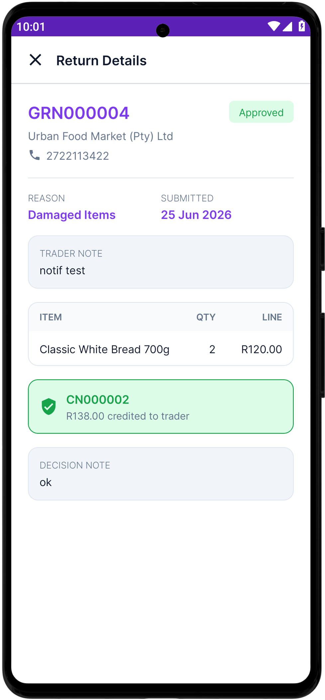</td>
<td>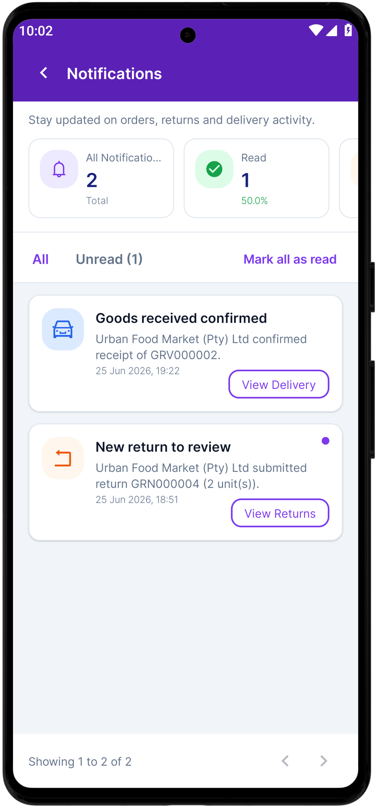</td>
<td>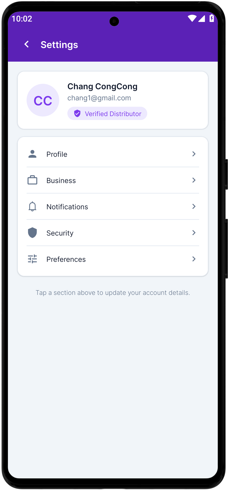</td>
<td></td><td></td><td></td>
</tr>
<tr>
<td align="center"><sub>Return detail</sub></td><td align="center"><sub>Notifications</sub></td><td align="center"><sub>Settings</sub></td><td></td><td></td><td></td>
</tr>
</table>

</details>

---

## Features

| Area | Capability |
| --- | --- |
| **Dashboard** | Revenue and order KPIs, sparklines, category donut, recent orders, wallet balance |
| **Catalogue** | Create and edit products, media upload, category and pricing management |
| **Inventory** | Per-store stock levels, set-stock, transfers, goods receipt, stock-movement history |
| **Stores** | Multi-warehouse management with a Google Maps pin picker |
| **Traders** | Onboard retail customers, review applications, view trader detail |
| **Orders** | Accept, reject, pick, pack and dispatch incoming orders |
| **Deliveries** | Scheduling, per-delivery detail, mark-delivered |
| **Returns** | Goods-return (GRN) approval flow with credit notes |
| **Promotions** | Build campaigns over selected products, with media and stock allocation |
| **Finances &amp; Wallet** | Transaction ledger, income vs expenses, balance, top-up |
| **Card Machine** | POS terminal registry and payment reconciliation |
| **Airtime / VAS** | Customer onboarding, catalogue, subscriptions, transaction history |
| **Reports** | Generate and download server-rendered CSV reports |
| **Staff** | Warehouse staff accounts with their own sign-in |
| **Settings &amp; Support** | Profile, business, security and notification settings; ticketed support |
| **Push** | Firebase Cloud Messaging, token registered on login and removed on logout |

---

## Tech stack

- **Java 17** · `minSdk 24` (Android 7.0) · `compileSdk` / `targetSdk 34`
- AndroidX **AppCompat**, **Material Components**, ConstraintLayout, RecyclerView, CardView, ViewPager2, SwipeRefreshLayout
- **OkHttp 4.12** + **Gson 2.10** — a hand-rolled `ApiClient` / `Http` pair rather than Retrofit, so requests map directly onto the backend's `{ status, message, data }` envelope
- **Glide 4.16** — image loading and caching
- **Firebase Cloud Messaging** (BoM 33.7) — push notifications
- **Play Services Maps 18.2** — store geolocation picker
- **hbb20 CCP 2.7.3** — country-code phone picker with flags and search

No Retrofit, no Dagger/Hilt, no Room — the app deliberately stays close to the framework.

---

## Getting started

### Prerequisites

- Android Studio Hedgehog (2023.1.1) or newer
- JDK 17
- Android SDK 34

### Build

```bash
./gradlew assembleDebug       # macOS / Linux
gradlew.bat assembleDebug     # Windows
```

The APK lands in `app/build/outputs/apk/debug/app-debug.apk`.

To run from the IDE: **File → Open**, select this folder, wait for Gradle sync, then deploy to any API 24+ device or emulator.

### Configuration

No credentials are committed — the files below are git-ignored so live keys never reach the repository. Supply your own before building:

| What | Where |
| --- | --- |
| API base URL | `ApiClient.BASE_URL` in `network/ApiClient.java` |
| Google Maps API key | `app/src/main/res/values/google_maps_api.xml` |
| Firebase / FCM | `app/google-services.json` |

```bash
# 1. Maps key — copy the template into place and edit it
cp google_maps_api.xml.example app/src/main/res/values/google_maps_api.xml

# 2. Firebase — download google-services.json from your Firebase project
#    (Project settings → Your apps → Android app "com.anokix.distributorapp")
#    and drop it in app/
```

Create your own Firebase project and Google Cloud API key, enable **Maps SDK for Android**, and restrict the key to the `com.anokix.distributorapp` package plus your signing SHA-1. The Gradle build applies the `com.google.gms.google-services` plugin, so **`app/google-services.json` must exist or the build will fail.**

---

## Project structure

```
app/src/main/java/com/anokix/distributorapp/
├── data/          DistributorRepository — API and mock implementations behind one interface
├── model/         Domain models and formatters
├── network/       ApiClient (typed endpoints) → Http (OkHttp transport) → dto/
├── session/       SessionManager — token persistence in SharedPreferences
├── messaging/     FCM service + PushManager (token register / unregister)
└── ui/            Activities, RecyclerView adapters, shared base classes
```

- **Auth** is a bearer token from `api/common/login`, persisted locally and attached to every later request. Registration can land in a *pending approval* state, rendered as its own screen.
- **`RepositoryProvider`** swaps the API repository for `MockDistributorRepository`, so every screen can be developed and demoed with no backend — which is how the captures above were produced.
- **`BaseActivity` / `BaseListActivity` / `BaseSecondaryActivity`** carry the shared chrome (drawer, headers, list scaffolding) so individual screens stay small.

---

## Related repositories

| App | Platform |
| --- | --- |
| anokiX Distributor | Android *(this repo)* · iOS |
| anokiX Trader | Android · iOS |

---

## Status

All screens are implemented; the app is at version 1.0.7 (versionCode 107). The backend API is offline, so the app currently runs against its bundled mock data.

## License

Released under the [MIT License](LICENSE).
